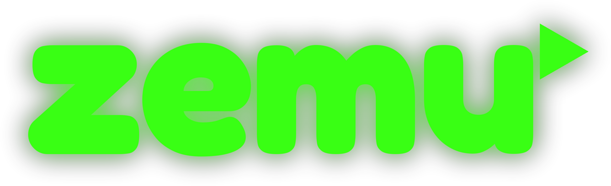
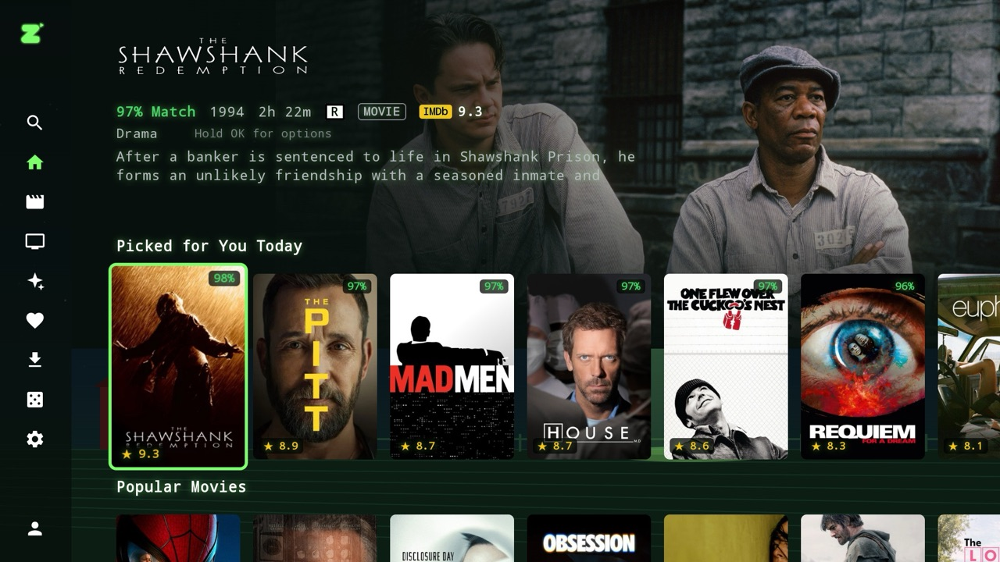
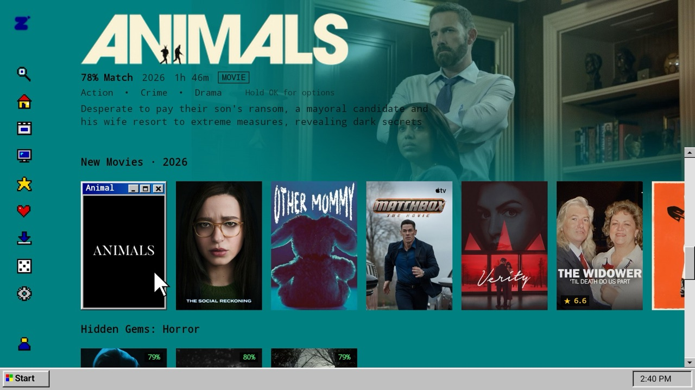
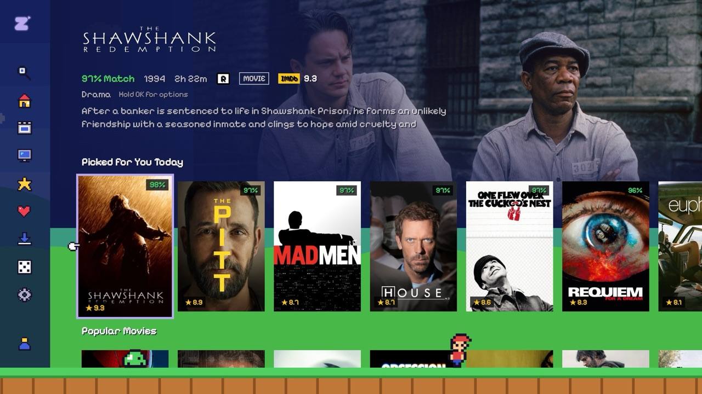
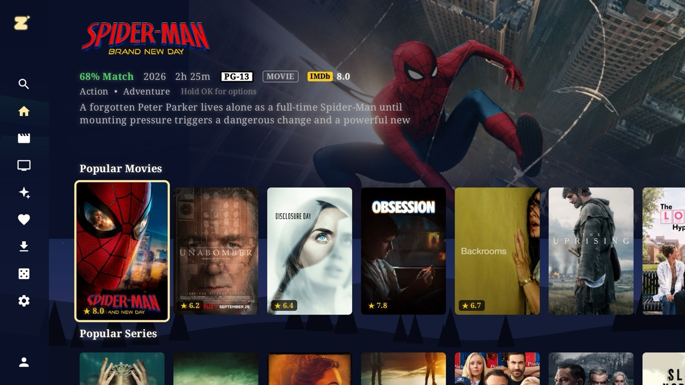
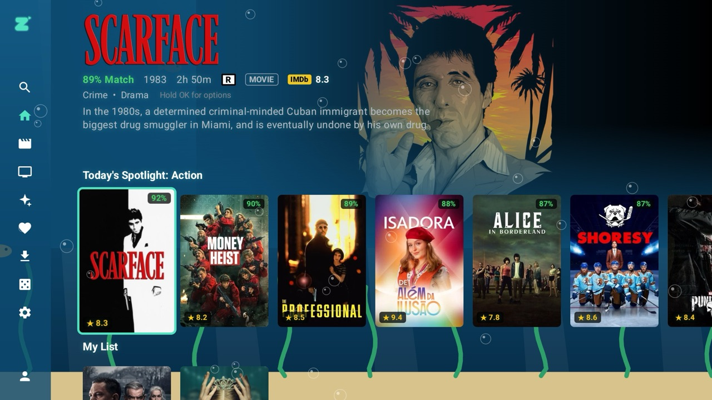
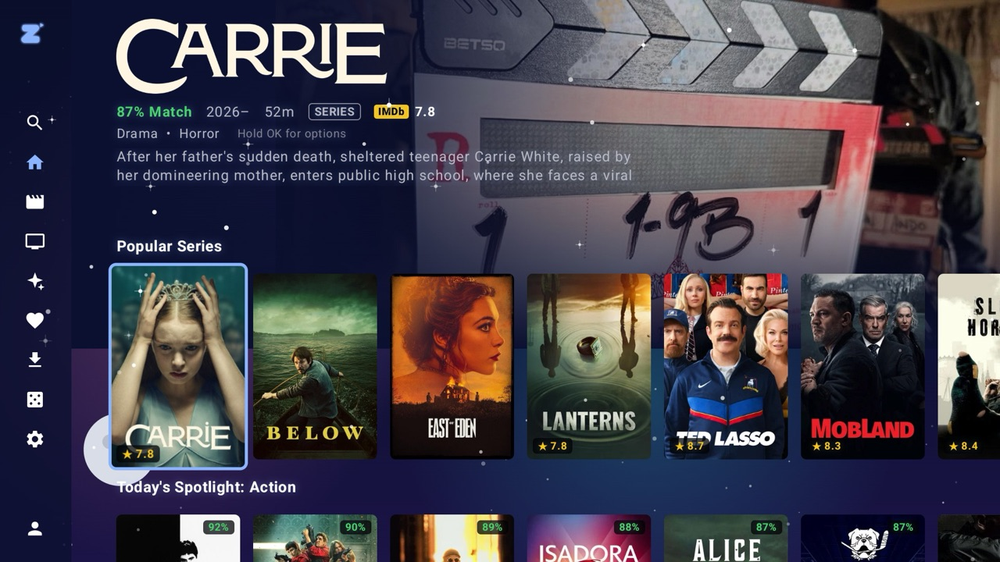
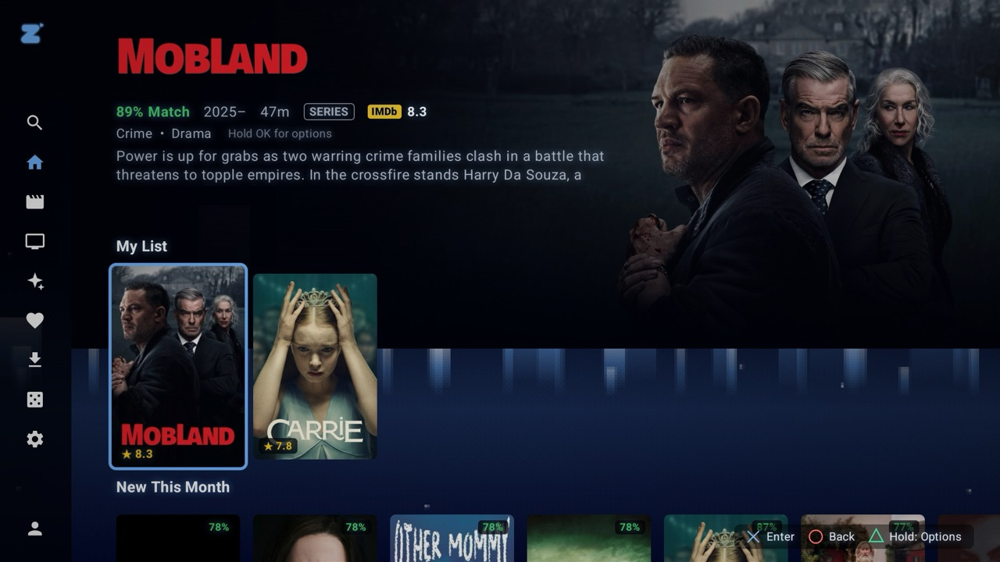
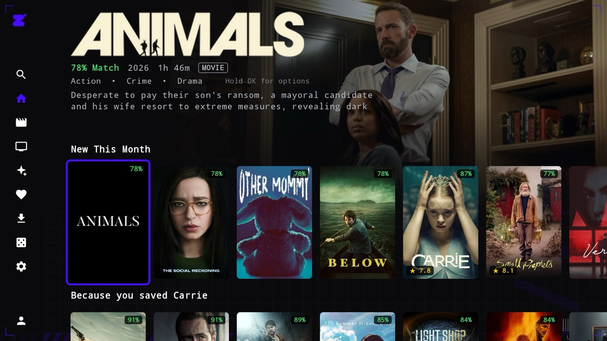
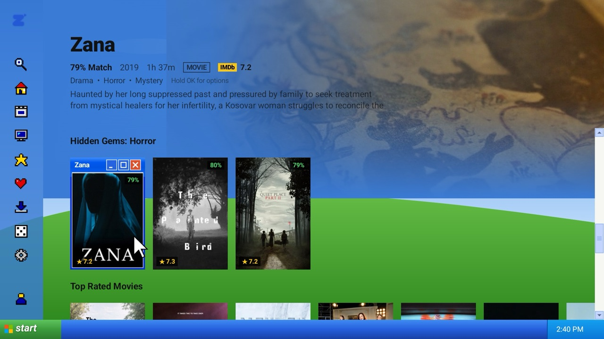

<p align="center"></p>

<p align="center"><b>A TV app that looks and feels like a streaming service, for people who use Stremio addons and a debrid service.</b><br>
Android TV · Google TV · Roku · Linux</p>

<p align="center"><a href="https://github.com/demerzelle/Zemu/releases/latest"><b>Download the latest version</b></a></p>

<p align="center"></p>

## Before you start

- **You need a debrid account to watch anything.** Zemu plays streams through a debrid service such as Real-Debrid, AllDebrid, Premiumize or TorBox. These are **paid subscriptions** (a few dollars a month). Zemu itself is free.
- **Zemu doesn't host, index or provide any content.** It shows what the addons you install return, and only plays streams your debrid service already has ready ("cached"), so playback starts right away.
- **It isn't in any app store.** You install it by hand ("sideloading"); see [Install](#install).

## What you can do with it

- **Browse like Netflix.** A big picture of the selected title, its logo, rating and description at the top, with rows of posters below. Trailers fade in behind the title after a few seconds (you can turn that off).
- **Get picks that change every day.** "Picked for You Today", "Because you watched…", hidden gems, new this month, and a "% Match" on every title based on what you watch, like and save.
- **See what's coming.** A **Coming Up** row lists new episodes of the shows you follow, with their air dates.
- **Can't decide?** **Surprise me** in the side menu plays something picked for you.
- **Save for later.** "Watch later" keeps a separate queue under My List; Search shows it and the titles you opened lately before you type.
- **Friends' picks** (with Trakt): "Recommend to friends" on any title, and a **From Friends** row on Home shows what your Trakt friends recommend.
- **Pick up where you left off.** Continue Watching on Home (and on the Android TV home screen), next-episode autoplay, and Skip intro / Skip recap buttons.
- **Profiles for everyone.** Each person gets their own history, My List, recommendations and look. Pick a picture or send a photo from your phone.
- **Kid profiles.** Only family and kids' titles show, limited to the ratings you allow. Leaving a kid profile or opening Settings needs a 4-digit parent code.
- **Subtitles in your language,** found automatically even when your addons have none, with adjustable size, color and background.
- **Make it look how you like.** Color themes, 19 animated themes, your own colors, fonts and text size. [See the themes](#themes).
- **Optional extras with free accounts:** Rotten Tomatoes and Metacritic scores (free OMDb key), cast photos and studio logos (free TMDB key), and Trakt sync for your watchlist and history.
- **Downloads for offline viewing** (Android TV, off by default; turn on in Settings → Playback).

## Themes

Every theme changes the whole app: its background scene, shapes, fonts and sounds. Any color in any theme can be changed, and you can save your own palettes. After you switch themes, Zemu asks **Keep changes?** and switches back on its own if you don't answer, so you can't get stuck with an unreadable screen.

| | |
|:-:|:-:|
| <br>**Cybercore** · a Windows 98-style desktop (also XP and Kawaii) | <br>**16-Bit** · a side-scrolling game world |
| <br>**Night Sky** · moon, aurora and shooting stars | <br>**Ocean** · fish, kelp and bubbles |
| <br>**Outer Space** · nebulas, a galaxy and a rocket | <br>**PS2 · Y2K** · glowing towers |
| <br>**Acidwave** · a sci-fi interface | <br>**Cybercore XP** · posters open in little windows |

Also: Alien Abduction, Pocket LCD, Ethereal, Graffiti, Liquid Glass, Cyberpunk, Matrix, Sakura, Fireflies, Weather, Holidays and RGB, plus OLED Black and High Contrast color themes.

## Install

Download the file for your TV from the [latest release](https://github.com/demerzelle/Zemu/releases/latest).

**Android TV / Google TV** (tested on an onn 4K box): the quickest way is the **Downloader** app: enter the code **6414692** (or `aftv.news/6414692`) and it downloads the newest Zemu APK to install. Or download `Zemu-AndroidTV-<version>.apk` and install it with an app such as Send Files to TV, or with `adb install`. The `.zip` holds the same APK. Fire TV runs Android too and will probably work, but it hasn't been tested.

**Roku:** Roku only allows apps outside its store in **developer mode**.
1. On the remote, press Home 3×, Up 2×, Right, Left, Right, Left, Right, and follow the steps to turn on developer mode and set a password.
2. On a computer on the same Wi-Fi, open the address the TV shows, sign in as `rokudev` with that password, upload `Zemu-Roku-<version>.zip` and press **Install**.

**Linux** (any distro with Java 17+; x64 and ARM64): download `Zemu-Linux-<version>.tar.gz`, then
```bash
tar -xzf Zemu-Linux-*.tar.gz && sh zemu/install.sh
```
It installs Java and mpv if needed (asks for your password), adds Zemu to your apps menu and the `zemu` command. Videos play in mpv. See [linux/README.md](linux/README.md).

**Updates:** Android TV checks for a new release when it starts and offers **Update now** (allow Zemu to install apps the first time). Roku tells you a new version is out; install its zip the same way as above. To publish one: `./release.sh 1.0.2 "What changed"`.

**Mac:** a Mac app is in `macos/`. The last packaged Mac build is in [release 1.0.0](https://github.com/demerzelle/Zemu/releases/tag/v1.0.0); newer versions have to be built from source.

The Android TV app is the most complete. The Roku, Mac and Linux apps share most of its features but not all of them (for example, downloads are Android and Linux only).

## First-time setup

1. Open Zemu. The catalogs (Cinemeta) and subtitles (OpenSubtitles) are added for you.
2. Go to **Settings → Quick setup** and link your debrid account. Zemu shows a code to enter on your phone and sets up a stream addon for you.
   - Already have an addon you like (AIOStreams, Torrentio, Comet, MediaFusion…)? Open **Addons** in the menu and paste its link. To skip typing with the remote, open the address shown on screen on your phone and paste it there.
3. Optional: add a free TMDB key in Quick setup for cast photos, logos and streaming-service rows, and set your languages in **Settings → Streams & languages**.

## Good to know

- The Android app is signed with a development key, not a store key. Android may warn about installing it; that's expected for sideloaded apps.
- Your settings, profiles and history stay on the TV. Zemu has no account, ads, analytics or tracking. It only contacts the addons and debrid service you set up, the public services it uses for artwork, trailers (YouTube), subtitles, ratings and intro timestamps, and Trakt, TMDB or OMDb if you add them.
- This is a personal project, shared as is.

## For tinkerers

Technical details, for people who like them:

- **Stremio addon browser:** Installed, Official and Community catalogs plus stremio-addons.net, with Install / Configure / Uninstall. Configure opens the addon's own setup page on the TV with a D-pad cursor.
- **Any metadata provider:** Cinemeta can be swapped for another metadata addon.
- **Stream filters and ranking:** filter by audio and subtitle language, size, quality, HDR / Dolby Vision, codec, audio format, channels, source, debrid service and addon. "Best for this TV" ranks streams by what your TV's decoders, HDR and audio passthrough can actually handle.
- **A player that recovers:** on decoder errors it retries with Dolby Vision as HDR10, then software video decoders, then FFmpeg audio (DTS, TrueHD, E-AC3), then the next cached stream, and remembers what worked. VLC and other external players are supported.
- **Skip intro / recap** timestamps come from [TheIntroDB](https://theintrodb.org) and [AniSkip](https://aniskip.com).
- **Other devices profile:** built from your debrid account's recent history.
- **Voice search** on remotes with a mic, touch screens, and a phone widget.

### How "cached" is decided

A stream is shown only if **both** are true:

- it has a direct `http(s)` URL (not an `infoHash` torrent), and
- the addon marks it as cached (`[RD+]`, `⚡`, `✅`, "cached", "instant") and does **not** mark it as uncached ("download", `⏳`, `⬇`, "uncached").

See `app/src/main/java/com/zemu/tv/streams/StreamParser.kt`. Plain HTTP addons without debrid markers are hidden unless you turn on **Treat direct links as cached** in Settings.

### Building it yourself

Requires JDK 17–21 and the Android SDK (API 35). The easiest way is to open this folder in Android Studio and click Run.

From a terminal, use a Java 17–21 runtime. Gradle 8.11 can't run on Java 25, which is what recent Android Studio versions bundle:

```bash
export JAVA_HOME=~/Library/Java/JavaVirtualMachines/jbr-21.0.11/Contents/Home
./gradlew assembleDebug                  # APK: app/build/outputs/apk/debug/app-debug.apk
./gradlew test                           # stream-parser unit tests
adb connect <tv-ip> && adb install -r app/build/outputs/apk/debug/app-debug.apk
```

### Project layout

```
data/        Stremio protocol models, addon client & repository, persistence, cached-availability checks
streams/     Stream parsing, language detection, device capabilities, filter + ranking engine
recommend/   Taste profile, similarity scoring, % Match
player/      Media3 player activity + external-player handoff
ui/          Compose for TV screens: home, details, browse, search, my list, downloads, settings, themes
roku/        The Roku app (BrightScript / SceneGraph)
linux/       The Linux app (Compose Desktop, reusing the Android app's Kotlin)
macos/       The macOS app (Swift)
```
